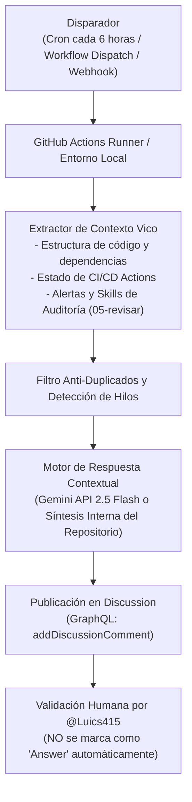

# Arquitectura del Agente Centinela de GitHub Discussions

## Propósito

El **Agente Centinela de Discussions** es un componente autónomo del portafolio oficial de Luis Rivera ([`Luics415.github.io`](https://github.com/Luics415/Luics415.github.io)). Su función es monitorizar de forma periódica (cada 6 horas o mediante eventos) las preguntas y discusiones abiertas en la pestaña de **GitHub Discussions**, generando respuestas técnicas contextualizadas exclusivamente en la arquitectura del proyecto (TanStack Start, React 19, Tailwind CSS v4, Vite 8, sin backend persistente, despliegue estático en GitHub Pages y pipeline de 6 fases).

---

## Flujo Operativo y Principios de Diseño



---

## Directrices Clave de Seguridad y Moderación

1. **Uso de la Cuenta del Propietario (`@Luics415`):**
   - Para evitar bloqueos heurísticos de spam o alertas de cuentas de bots no verificadas, las respuestas se publican autenticadas mediante el token configurado en GitHub Secrets (`LUICS_PAT` o `GITHUB_TOKEN`).
2. **Validación Humana Obligatoria (Sin Auto-Answer):**
   - El agente ejecuta la mutación GraphQL `addDiscussionComment`, pero **nunca** invoca `markDiscussionCommentAsAnswer`. Esto garantiza que la insignia verde de respuesta oficial dependa de la revisión y confirmación explícita de Luis Rivera.
3. **Pie de Página y Transparencia:**
   - Todo comentario incluye la leyenda obligatoria:
     ```markdown
     ---
     > 🤖 *Respuesta técnica generada automáticamente por el Agente Autónomo del Portafolio en base al estado y arquitectura del repositorio. Pendiente de validación por @Luics415.*
     ```
4. **Prevención de Respuestas Genéricas:**
   - El agente no responde con definiciones genéricas de internet desconectadas del proyecto. Si se le pregunta sobre seguridad o secretos, explica cómo se gestionan en este portafolio estático (GitHub Secrets, habilidad `05-revisar` pre-merge y ausencia de `.env` en producción).

---

## Archivos del Componente

- **Script Ejecutor:** [`.github/scripts/discussions_centinel.py`](../.github/scripts/discussions_centinel.py)
  - Escrito con la biblioteca estándar de Python 3 (sin dependencias externas).
  - Compatible con Windows, Linux (GitHub Actions) y macOS.
  - Soporta `--dry-run`, `--discussion-number`, `--force`.
- **Workflow Automatizado:** [`.github/workflows/discussions-centinel.yml`](../.github/workflows/discussions-centinel.yml)
  - Configurado con cron `0 */6 * * *`, disparadores por evento (`discussion`, `discussion_comment`) y `workflow_dispatch`.
