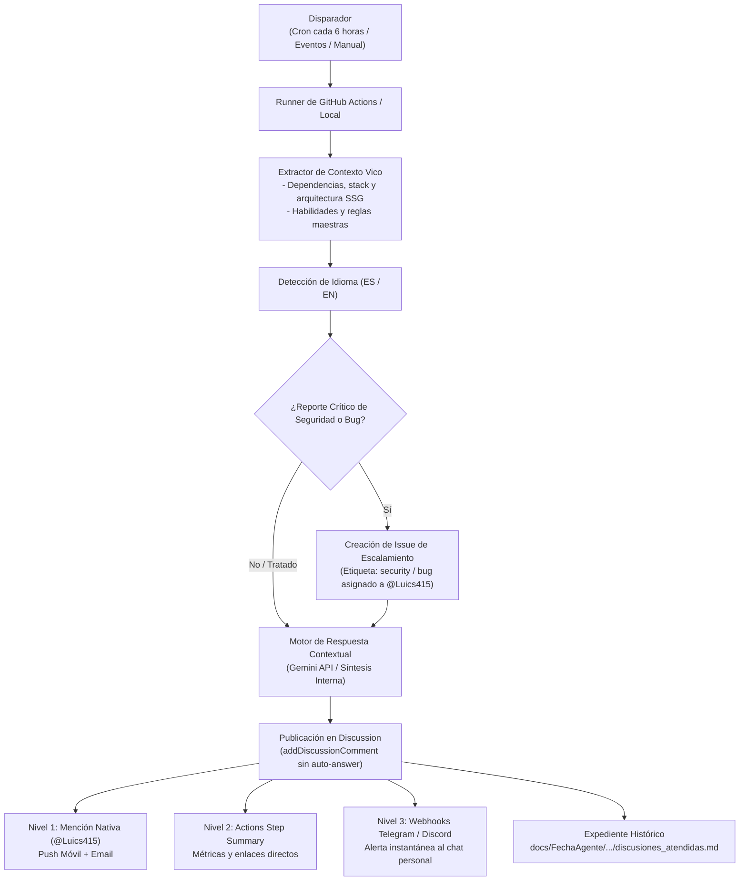

# Arquitectura del Agente Centinela de GitHub Discussions

## Propósito

El **Agente Centinela de Discussions** es un componente autónomo del portafolio oficial de Luis Rivera ([`Luics415.github.io`](https://github.com/Luics415/Luics415.github.io)). Su función es monitorizar de forma periódica (cada 6 horas o mediante eventos) las preguntas y debates abiertos en **GitHub Discussions**, ofreciendo respuestas técnicas contextualizadas en la arquitectura del proyecto, soporte bilingüe, notificaciones multicanal y escalamiento de incidentes críticos.

Está diseñado con una estructura desacoplada y portable para ser replicado en proyectos como **Dev Visualizer** y futuros repositorios.

---

## Flujo Operativo y Capacidades



---

## Los Tres Niveles de Notificación

1. **Nivel 1 (Mención Nativa en GitHub):**
   - El comentario incluye obligatoriamente:
     ```markdown
     > 🔔 **Aviso para @Luics415:** Respuesta lista para tu revisión. Puedes [validarla y marcarla como definitiva aquí](...).
     ```
   - Dispara automáticamente las notificaciones push en la app móvil de GitHub y correos electrónicos asociados a tu cuenta.
2. **Nivel 2 (GitHub Actions Step Summary):**
   - Cada ciclo de ejecución publica una tabla con el estado de las discusiones atendidas, el idioma detectado, alertas de escalamiento y enlaces de acceso rápido.
3. **Nivel 3 (Webhooks de Mensajería Externa):**
   - Compatible con **Telegram** (`TELEGRAM_BOT_TOKEN`, `TELEGRAM_CHAT_ID`) y **Discord** (`DISCORD_WEBHOOK_URL`).
   - Envía un mensaje instantáneo a tu chat privado con el título de la duda, usuario y botón directo para validar.

---

## Escalamiento de Seguridad y Bugs

Si una consulta contiene términos relacionados con vulnerabilidades o fallos críticos (`vulnerability`, `exploit`, `inyección`, `fuga crítica`, `cve`, etc.):
1. El agente responde con empatía e informa que el tema ha sido transferido al mantenedor.
2. Abre de forma automatizada un **Issue interno asignado a @Luics415** etiquetado como `security` o `bug`.

---

## Guía de Réplica para Otros Proyectos (ej. Dev Visualizer)

Para instalar el centinela en otro proyecto:
1. Copiar `.github/scripts/discussions_centinel.py` al nuevo repositorio.
2. Copiar `.github/workflows/discussions-centinel.yml`.
3. Copiar la especificación `.agents/skills/centinela-discussions/SKILL.md`.
4. Configurar opcionalmente los Secrets en GitHub (`GEMINI_API_KEY`, `TELEGRAM_BOT_TOKEN`, `TELEGRAM_CHAT_ID`, `DISCORD_WEBHOOK_URL`).
